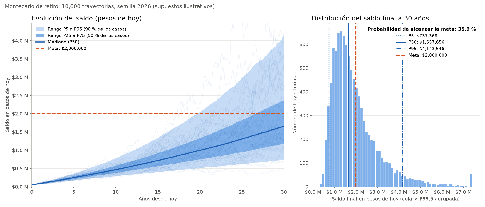

# Simulación de Montecarlo para el ahorro para el retiro

Actividad de **Pensamiento de Ingeniería**. Programa en Python que estima los posibles
valores futuros de una inversión para el retiro con el
[método de Montecarlo](https://es.wikipedia.org/wiki/M%C3%A9todo_de_Montecarlo): en lugar
de suponer un único rendimiento fijo, simula **10 000 futuros posibles** mes a mes y
resume qué tan probable es cada resultado.

> **Aviso.** Todos los supuestos son **ilustrativos**. Esto es un ejercicio académico, no un
> pronóstico ni una asesoría financiera.



## Contenido del repositorio

| Archivo | Qué contiene |
|---|---|
| [`montecarlo_retiro.py`](montecarlo_retiro.py) | Simulación, estadísticas, reporte, gráfica y línea de comandos (comentado en español) |
| [`tests/test_montecarlo_retiro.py`](tests/test_montecarlo_retiro.py) | 40 pruebas: casos deterministas, reproducibilidad y validaciones |
| [`resultados/salida_ejemplo.txt`](resultados/salida_ejemplo.txt) | Salida de ejemplo con los parámetros por defecto |
| [`resultados/grafica_ejemplo.png`](resultados/grafica_ejemplo.png) | Gráfica de ejemplo |
| [`requirements.txt`](requirements.txt) | Dependencias |

## Instalación

Requiere Python 3.10 o más reciente.

```bash
git clone https://github.com/armani-av/montecarlo-retiro.git
cd montecarlo-retiro
python -m venv .venv
```

Activa el entorno virtual:

```bash
# Windows (PowerShell)
.venv\Scripts\Activate.ps1
# macOS / Linux
source .venv/bin/activate
```

Instala las dependencias (NumPy, Matplotlib y pytest):

```bash
pip install -r requirements.txt
```

## Cómo ejecutarlo

Con los parámetros por defecto (reproduce `resultados/salida_ejemplo.txt`):

```bash
python montecarlo_retiro.py --salida resultados/salida_ejemplo.txt --grafica resultados/grafica_ejemplo.png
```

Con supuestos propios. **Las tasas se escriben en porcentaje** (`8` significa 8 %):

```bash
python montecarlo_retiro.py --saldo-inicial 100000 --aportacion-mensual 5000 --anios 25 --rendimiento 7 --volatilidad 12 --inflacion 4.5 --comision 0.57 --meta 3000000 --semilla 42 --simulaciones 20000
```

| Parámetro | Significado | Por defecto |
|---|---|---|
| `--saldo-inicial` | Dinero ahorrado hoy (pesos) | 50 000 |
| `--aportacion-mensual` | Aportación mensual en pesos de hoy | 3 000 |
| `--anios` | Años de inversión | 30 |
| `--rendimiento` | Rendimiento anual esperado, nominal (%) | 8 |
| `--volatilidad` | Volatilidad anual (%) | 15 |
| `--inflacion` | Inflación anual (%) | 4 |
| `--comision` | Comisión anual sobre el saldo (%) | 0.55 |
| `--meta` | Meta de retiro en **pesos de hoy** | 2 000 000 |
| `--semilla` | Semilla aleatoria (misma semilla = mismos resultados) | 2026 |
| `--simulaciones` | Número de trayectorias (mínimo 10 000) | 10 000 |
| `--aportacion-al-final` | Aportar al final de cada mes en vez de al inicio | inicio |
| `--sin-indexar` | Dejar la aportación nominal fija (no subirla con la inflación) | indexada |
| `--grafica` | Ruta del PNG | `resultados/grafica.png` |
| `--salida` | Ruta para guardar el reporte en texto | (no se guarda) |
| `--mostrar` | Abrir la gráfica en una ventana | no |

`python montecarlo_retiro.py --help` muestra la misma ayuda.

Para correr las pruebas:

```bash
python -m pytest -v
```

## Supuestos y fórmulas

### 1. Distribución de los rendimientos

Cada mes el saldo se multiplica por un factor aleatorio

$$R_t = e^{X_t}, \qquad X_t \sim \mathcal{N}(m,\ s^2) \text{ independientes entre meses.}$$

Es decir, el **rendimiento logarítmico** mensual es normal y el factor de crecimiento es
**log-normal** (el modelo clásico de movimiento browniano geométrico). Se eligió así porque:

- el saldo nunca puede volverse negativo por los rendimientos (una pérdida de 100 % o más es
  imposible), cosa que sí podría pasar si se sortearan rendimientos simples con una normal;
- los rendimientos logarítmicos de varios meses se suman, lo que facilita pasar de tasas
  anuales a mensuales.

### 2. Conversión de tasas anuales a mensuales

Sea $\mu$ el rendimiento anual esperado y $\sigma$ la volatilidad anual.

$$s = \frac{\sigma}{\sqrt{12}}, \qquad m = \frac{\ln(1+\mu)}{12} - \frac{s^2}{2}$$

- **Volatilidad:** con meses independientes, las varianzas se suman: $\sigma^2 = 12\,s^2$.
- **Media:** para una log-normal, $E[e^{X}] = e^{m + s^2/2}$. Restar $s^2/2$ (corrección de
  convexidad) hace que $E[R_t] = (1+\mu)^{1/12}$ y que el factor esperado de un año sea
  exactamente $1+\mu$. Sin la corrección, la simulación sobreestimaría el rendimiento.
- **Inflación y comisión** se convierten con tasa compuesta equivalente, no dividiendo entre 12:

$$\pi_m = (1+\pi)^{1/12} - 1, \qquad f_c = (1-c)^{1/12}$$

  de modo que doce meses componen exactamente la tasa anual.

Con los valores por defecto: $m = 0.005476$, $s = 0.043301$, $\pi_m = 0.3274\,\%$.

### 3. Cuándo se hacen las aportaciones y orden de operaciones

Para cada mes $t = 1, \dots, n$ (con $n = 12 \times$ años), y para cada trayectoria:

1. Si la aportación es **al inicio** del mes (por defecto): $S \leftarrow S + A_t$.
   El dinero entra y ya gana el rendimiento de ese mes (anualidad anticipada).
2. Rendimiento del mercado: $S \leftarrow S \cdot R_t$.
3. Comisión: $S \leftarrow S \cdot f_c$.
4. Si la aportación es **al final** del mes (`--aportacion-al-final`): $S \leftarrow S + A_t$
   (anualidad vencida; ese mes la aportación no gana nada).

La aportación del mes $t$ es $A_t = A\,(1+\pi_m)^{t-1}$ si está **indexada** (por defecto:
sube con la inflación para mantener su poder de compra), o $A_t = A$ si se usa `--sin-indexar`.

### 4. Pesos nominales y pesos de hoy

- **Pesos nominales:** el número que aparecería en el estado de cuenta en ese futuro.
- **Pesos de hoy (reales):** cuánto poder de compra representa ese saldo a precios actuales.

$$S^{\text{hoy}}_t = \frac{S^{\text{nominal}}_t}{(1+\pi)^{t/12}}$$

Con 4 % de inflación, $1 en 30 años compra lo que hoy compran unos $0.31, por eso los valores
nominales se ven mucho más grandes. **La meta se expresa en pesos de hoy**; compararla en pesos de
hoy equivale a compararla en nominal contra la meta inflada al año de retiro (hay una prueba
que lo verifica).

### 5. Estadísticas que se reportan

Sobre los $N$ saldos finales simulados:

- **Media** y **percentiles 5, 25, 50, 75 y 95** (interpolación lineal de NumPy).
- **Probabilidad de alcanzar la meta:** $\hat p = \frac{1}{N}\sum_i \mathbf{1}[S^{\text{hoy}}_{i,n} \ge \text{meta}]$,
  con su error estándar de Montecarlo $\sqrt{\hat p(1-\hat p)/N}$, que indica cuánto podría
  cambiar la estimación solo por usar un número finito de trayectorias.
- **Valor sin volatilidad:** el resultado si todos los meses rindieran exactamente lo esperado;
  sirve de referencia para ver el efecto de la incertidumbre.

### Implementación

Los $N \times n$ rendimientos se generan de una sola vez con `numpy.random.default_rng(semilla)`.
Después se recorre mes por mes actualizando las $N$ trayectorias en paralelo (vectorizado), lo que
simula 10 000 trayectorias de 30 años en pocos segundos.

## Salida de ejemplo

Con los parámetros por defecto y semilla 2026 ([archivo completo](resultados/salida_ejemplo.txt)):

```text
Total aportado (incluye saldo inicial): $2,105,812 nominales = $1,130,000 pesos de hoy
Valor final sin volatilidad (rendimiento constante): $1,954,179 pesos de hoy

Valor final al cabo de 30 años:
  Estadístico                  Pesos nominales          Pesos de hoy
  ------------------------------------------------------------------
  Media                             $6,331,916            $1,952,248
  Percentil 5                       $2,391,576              $737,368
  Percentil 25                      $3,821,398            $1,178,208
  Percentil 50                      $5,376,436            $1,657,656
  Percentil 75                      $7,690,206            $2,371,034
  Percentil 95                     $13,439,168            $4,143,546

Probabilidad de alcanzar la meta: 35.88 %  (error estándar de Montecarlo: +/- 0.48 puntos)
```

## Cómo interpretar los resultados

- **Percentil 5 = $737 368 de hoy:** en el 5 % de los futuros simulados más desfavorables el
  saldo queda por debajo de esto. Es un escenario pesimista razonable para planear.
- **Mediana (P50) = $1 657 656 de hoy:** la mitad de los futuros termina arriba y la mitad abajo.
  Es el resultado "típico".
- **Media = $1 952 248 de hoy:** es mayor que la mediana porque la distribución log-normal tiene
  una cola larga a la derecha (pocos escenarios muy buenos jalan el promedio hacia arriba). Por
  eso la mediana es mejor guía que la media para una sola persona.
- **Valor sin volatilidad ≈ media, pero > mediana:** la incertidumbre no cambia el promedio
  esperado, pero sí hace que el resultado típico sea menor (arrastre de volatilidad).
- **Probabilidad de 35.9 %:** con estos supuestos, alrededor de 1 de cada 3 futuros alcanza la meta
  de $2 000 000 de hoy. Para subirla se puede aportar más, empezar antes, invertir más años o bajar
  comisiones; el programa permite probar cada palanca.
- **Nominal vs. hoy:** los $5.4 millones nominales de la mediana equivalen a $1.66 millones de hoy.
  Leer solo la columna nominal haría pensar que se tiene más del triple de poder de compra.
- **Gráfica izquierda:** abanico del saldo en pesos de hoy. La banda clara contiene al 90 % de las
  trayectorias y la oscura al 50 %; las líneas tenues son trayectorias individuales.
  **Gráfica derecha:** histograma del saldo final con los percentiles y la meta.

## Limitaciones

- **Rendimientos independientes y normales en logaritmo:** el modelo no captura colas pesadas
  (crisis más frecuentes de lo que predice la normal), rachas ni reversión a la media.
- **Parámetros constantes:** rendimiento, volatilidad, inflación y comisión no cambian en 30 años.
  En la realidad varían, y la inflación también es incierta (aquí es determinista).
- **Un solo activo:** no hay mezcla de renta fija y variable ni cambio de estrategia con la edad
  (como las SIEFORE generacionales).
- **Sin impuestos, aportaciones patronales o gubernamentales, retiros parciales ni periodos sin
  aportar** (desempleo, por ejemplo).
- **Solo la etapa de acumulación:** no simula cuánto dura el dinero ya en el retiro.
- **Los resultados dependen totalmente de los supuestos:** cambiar el rendimiento esperado de 8 % a
  6 % altera mucho la probabilidad. Las cifras no son una predicción.
- **Error de muestreo:** con 10 000 trayectorias la probabilidad tiene un error estándar de
  aproximadamente medio punto porcentual; con más trayectorias se reduce como $1/\sqrt{N}$.

## Pruebas

`tests/test_montecarlo_retiro.py` contiene 40 pruebas automáticas:

- **Deterministas** (volatilidad 0, donde el resultado debe coincidir con fórmulas cerradas):
  suma simple de aportaciones, interés compuesto $S_0(1+\mu)^{a}$, valor futuro de anualidades
  vencidas y anticipadas, comisión como factor $(1-c)$ anual, conversión a pesos de hoy y
  aportaciones indexadas que conservan su valor real.
- **Reproducibilidad:** la misma semilla produce matrices idénticas y el mismo reporte; semillas
  distintas producen resultados distintos.
- **Estadísticas:** la media simulada está a menos de 4 errores estándar del valor teórico,
  percentiles ordenados, media > mediana, probabilidad 100 % con meta 0 y 0 % con meta inalcanzable,
  y valores conocidos de percentiles.
- **Validaciones:** parámetros inválidos, mínimo de 10 000 trayectorias en la línea de comandos y
  conversión de porcentajes.

Resultado de la ejecución (Python 3.14, NumPy 2.5, Matplotlib 3.11):

```text
40 passed
```

## Referencias

- Wikipedia. *Método de Montecarlo*. https://es.wikipedia.org/wiki/M%C3%A9todo_de_Montecarlo
- Hull, J. C. *Options, Futures, and Other Derivatives*, capítulo sobre el movimiento browniano
  geométrico y la distribución log-normal de los precios.
